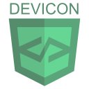

<div align="center">
  <a href="https://github.com/devicons/devicon">
    
  </a>
  <h3>Devicon</h3>
  <p>
    A curated collection of logos for programming languages, frameworks, and development tools.<br />
    Available as a font, as raw SVGs, or via CDN.
  </p>
  <p>
    <a href="https://devicon.dev">Website</a>
    &middot;
    <a href="https://github.com/devicons/devicon/issues/new?assignees=&labels=request%3Aicon&template=icon-request.md&title=Icon+request%3A+%5BNAME%5D">Request an Icon</a>
    &middot;
    <a href="#contributing">Contribute</a>
    &middot;
    <a href="https://discord.gg/hScy8KWACQ">Discord</a>
  </p>

  <a href="https://github.com/devicons/devicon/releases">
        
    </a>
    <a href="/LICENSE">
        
    </a>
    <a href="https://github.com/devicons/devicon/graphs/contributors">
        
    </a>
    <a href="https://github.com/devicons/devicon/actions">
        
    </a>
    <a href="https://github.com/devicons/devicon/issues?q=is%3Aopen+is%3Aissue+label%3Arequest%3Aicon">
        
    </a>
    <a href="https://github.com/devicons/devicon/stargazers">
        
    </a>
    <a href="https://devicon.dev/">
        
    </a>
    <a href="https://www.npmjs.com/package/devicon">
        
    </a>
    <a href="https://www.npmjs.com/package/devicon">
        
    </a>
</div>

<br />

## Table of Contents

- [About](#about)
- [Quick Start](#quick-start)
- [Usage](#usage)
  - [Font (recommended)](#font-recommended)
  - [Inline SVG](#inline-svg)
  - [Image tag](#image-tag)
  - [CDN](#cdn)
- [Requesting an Icon](#requesting-an-icon)
- [Contributing](#contributing)
- [Community](#community)
- [Branches](#branches)
- [Stale Pull Requests](#stale-pull-requests)
- [Tools](#tools)
- [Building Devicon](#building-devicon)
- [Acknowledgements](#acknowledgements)
- [Disclaimer](#disclaimer)

## About

Devicon gathers the logos of development languages and tools in one place. Every icon comes in several variants:

| Variant | Options |
| --- | --- |
| Format | Font or SVG |
| Style | `original`, `plain`, `line` |
| Color | Colored or monochrome |
| Wordmark | With or without |

Devicon has 600+ icons, and it's growing. See [`devicon.json`](/devicon.json) or [devicon.dev](https://devicon.dev) for the complete, up-to-date list.
<p>
    Thanks to all our contributors and the <a href="https://icomoon.io/#home">IcoMoon app</a>. Devicon would not be possible without you.
</p>

## Quick Start

```html
<!-- in your <head> -->
<link rel="stylesheet" href="https://cdn.jsdelivr.net/gh/devicons/devicon@latest/devicon.min.css">

<!-- in your <body> -->
<i class="devicon-devicon-plain"></i>
```

## Usage

For the fastest setup, head to [devicon.dev](https://devicon.dev). Otherwise, pick whichever method suits your project.

### Font (recommended)

Install Devicon with your package manager:

```bash
npm install --save devicon
# or
yarn add devicon
```

No package manager? Download [`devicon.min.css`](/devicon.min.css) and place it next to the [`fonts`](/fonts) folder in your project.

Include the stylesheet in your header:

```html
<link rel="stylesheet" href="devicon.min.css">
```

Then use icons with the `<i>` tag:

```html
<!-- plain -->
<i class="devicon-devicon-plain"></i>

<!-- plain with wordmark -->
<i class="devicon-devicon-plain-wordmark"></i>

<!-- plain, colored with the icon's brand color -->
<i class="devicon-devicon-plain colored"></i>

<!-- plain with wordmark, colored -->
<i class="devicon-devicon-plain-wordmark colored"></i>
```

### Inline SVG

Copy the SVG code from the [`icons`](https://github.com/devicons/devicon/tree/master/icons) folder or from [devicon.dev](https://devicon.dev) and paste it into your markup:

```html
<svg id="Devicon" class="devicon-devicon-plain" xmlns="http://www.w3.org/2000/svg" viewBox="0 0 128 128"><path id="plain" fill="#60be86" d="M64,7.83H4.77L14.95,95.13l49,25,.06,0,49.07-25L123.23,7.83Zm42.77,54.86c0,.88,0,1.67-.77,2L73.25,80.44l-2.42,1.13-.27-3.15V72.23l.24-1.57,1.09-.47L95.07,59.81l-21.54-9.6L64.35,68.34,58.9,78.87l-1.22,2.27-2.05-.9L22,64.71a2.42,2.42,0,0,1-1.45-2V56.91a2.39,2.39,0,0,1,1.42-2l34-15.73,3.21-1.44v9.66l.24,1.34-1.56.7L34.45,59.79,56.3,69.42l8.05-16,6.21-12.65,1.13-2.28,1.81.91L106,54.89c.73.35.76,1.14.76,2Z"/></svg>
```

Style it with CSS:

```css
.devicon-devicon-plain {
  max-width: 2em;
}

/* change the original color */
.devicon-devicon-plain path {
  fill: #4691f6;
}
```

### Image tag

Reference an SVG straight from the repository:

```html

```

### CDN

Devicon is served through [jsDelivr](https://www.jsdelivr.com/package/npm/devicon). See [devicon.dev](https://devicon.dev) for details on adding it to your project via CDN.

## Requesting an Icon

Missing a logo? [Open an icon request](https://github.com/devicons/devicon/issues/new?assignees=&labels=request%3Aicon&template=icon-request.md&title=Icon+request%3A+%5BNAME%5D). The [wiki](https://github.com/devicons/devicon/wiki/Requesting-an-Icon) has more information on what makes a good request.

## Contributing

Every contribution is welcome, whether it's new icons, features, or maintainers. The [wiki](https://github.com/devicons/devicon/wiki) explains how to get started.

## Community

Join the [official Discord server](https://discord.gg/hScy8KWACQ) to request icons, ask questions, and chat with other contributors.

## Branches

All official releases live on `master`. Everything in between (icons, features, experiments) is kept on `develop`.

| Branch | Contains |
| --- | --- |
| `master` | The latest official release with all SVGs and built icons. Official, tested changes only. |
| `develop` | The latest non-optimized SVGs, with no built icons for them (these are built at each release, or manually, see [Building Devicon](#building-devicon)). Experimental changes. |

## Stale Pull Requests

A pull request with no activity or response from the author for over 30 days is automatically marked as stale. We may fork your changes and merge them ourselves. Because GitHub tracks contributions by commit, you will still be credited.

## Tools

These are the tools and services we use to build, maintain, and distribute Devicon.

<table>
  <thead>
    <tr>
      <th align="center"></th>
      <th align="left">Tool</th>
      <th align="left">Used for</th>
    </tr>
  </thead>
  <tbody>
    <tr>
      <td align="center"></td>
      <td><a href="https://git-scm.com">Git</a></td>
      <td>Version control</td>
    </tr>
    <tr>
      <td align="center"></td>
      <td><a href="https://github.com/devicons/devicon">GitHub</a></td>
      <td>Hosting, issues, pull requests, and releases</td>
    </tr>
    <tr>
      <td align="center"></td>
      <td><a href="https://github.com/devicons/devicon/actions">GitHub Actions</a></td>
      <td>Automated checks, icon validation, and release workflows</td>
    </tr>
    <tr>
      <td align="center"></td>
      <td><a href="https://nodejs.org">Node.js</a> &amp; <a href="https://www.npmjs.com">npm</a></td>
      <td>Build scripts, dependencies, and publishing the <code>devicon</code> package</td>
    </tr>
    <tr>
      <td align="center"></td>
      <td><a href="https://www.python.org">Python</a></td>
      <td>Automation scripts and the local development server</td>
    </tr>
    <tr>
      <td align="center"></td>
      <td><a href="https://www.selenium.dev">Selenium</a></td>
      <td>Browser automation to generate the icon font</td>
    </tr>
    <tr>
      <td align="center"></td>
      <td><a href="https://www.mozilla.org/firefox">Firefox</a></td>
      <td>Browser used by Selenium during the icon build</td>
    </tr>
    <tr>
      <td align="center">🎨</td>
      <td><a href="https://icomoon.io/#home">IcoMoon</a></td>
      <td>Converting SVGs into the Devicon icon font</td>
    </tr>
    <tr>
      <td align="center"></td>
      <td><a href="https://www.gitpod.io">Gitpod</a></td>
      <td>One-click, preconfigured development environment</td>
    </tr>
    <tr>
      <td align="center">📦</td>
      <td><a href="https://www.jsdelivr.com">jsDelivr</a></td>
      <td>CDN delivery of the stylesheet, fonts, and SVGs</td>
    </tr>
    <tr>
      <td align="center"></td>
      <td><a href="https://discord.gg/hScy8KWACQ">Discord</a></td>
      <td>Community support and icon requests</td>
    </tr>
  </tbody>
</table>

## Building Devicon

Build the icons and website locally, or use Gitpod to skip the setup.

### Using Gitpod

[Gitpod](https://www.gitpod.io) installs the required dependencies and builds the icons in one click. No extra setup is needed.

[](https://gitpod.io/#https://github.com/devicons/devicon/tree/develop)

> [!NOTE]
> If a command doesn't run properly on Gitpod, follow the local steps below and run them in the Gitpod terminal.

### Local installation

#### 1. Prerequisites

| Requirement | Notes |
| --- | --- |
| [Git](https://git-scm.com/book/en/v2/Getting-Started-Installing-Git) | Needed to clone the repository |
| [Node.js and npm](https://kinsta.com/blog/how-to-install-node-js/) | Required to build Devicon |
| [Firefox](https://www.mozilla.org/en-US/firefox/new/) | Used for the icon build |
| [Python 3.8](https://www.python.org/downloads/) | Make sure your install includes [pip](https://pypi.org/project/pip/) |

#### 2. Clone and install dependencies

[Fork](https://github.com/devicons/devicon/fork) the repository, then clone your fork:

```bash
git clone https://github.com/<your-github-username>/devicon.git
cd devicon
```

Install the Node and Python dependencies:

```bash
npm install
python -m pip install -r ./.github/scripts/requirements.txt
```

#### 3. Build the icons

Icons are normally built on each release, but you can build the latest ones yourself for a sneak peek:

```bash
npm run build-icons
```

> [!NOTE]
> This can take a while, depending on your system and the number of icons. If you hit errors, please [create an issue](https://github.com/devicons/devicon/issues/new/choose) or reach out on [Discord](https://discord.gg/hScy8KWACQ).

#### 4. Build the CSS stylesheet

This generates the stylesheet that displays the newly built icons:

```bash
npm run build-css
```

#### 5. Start the web server

```bash
npm run dev   # runs on port 8000
```

Or choose your own port:

```bash
python -m http.server <port>
```

Done! 🎉 Your build is now available at `http://localhost:8000` (or your chosen port).

## Acknowledgements

Thanks to all of our [contributors](https://github.com/devicons/devicon/graphs/contributors) and to the [IcoMoon app](https://icomoon.io/#home). Devicon would not be possible without you.

## Disclaimer

All product names, logos, and brands are property of their respective owners. All company, product, and service names used in this project are for identification purposes only. Use of these names, logos, and brands does not imply endorsement. Please use these logos in accordance with each company, brand, or service's brand policy.

<br />
<div align="center">
  
  
</div>
